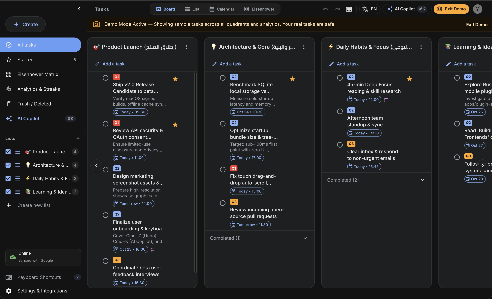
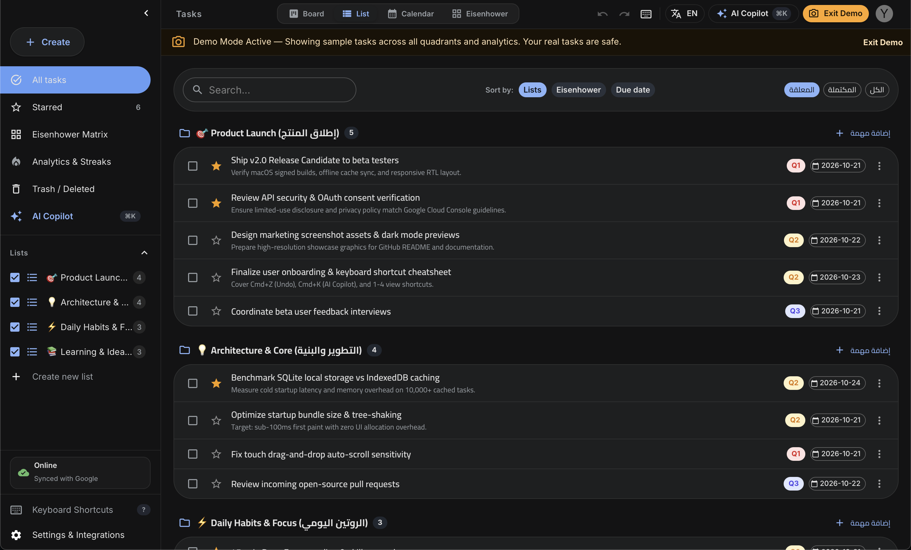
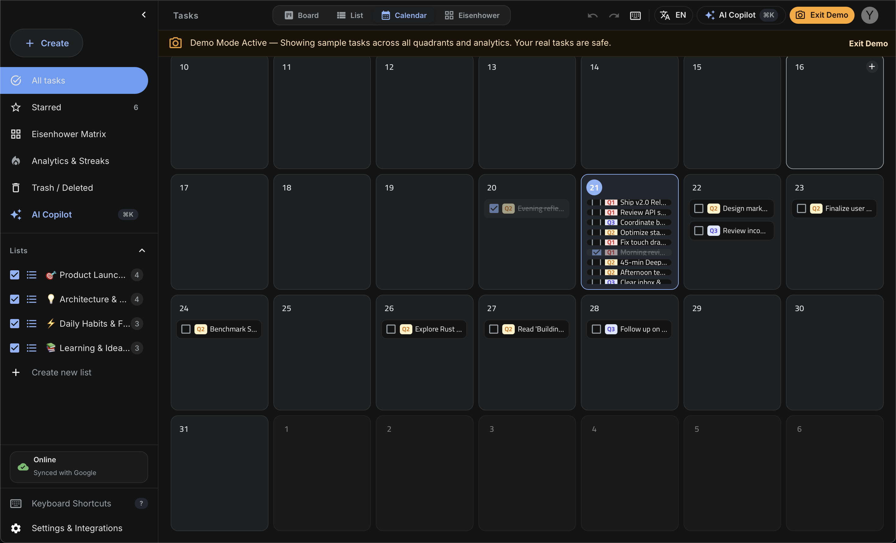
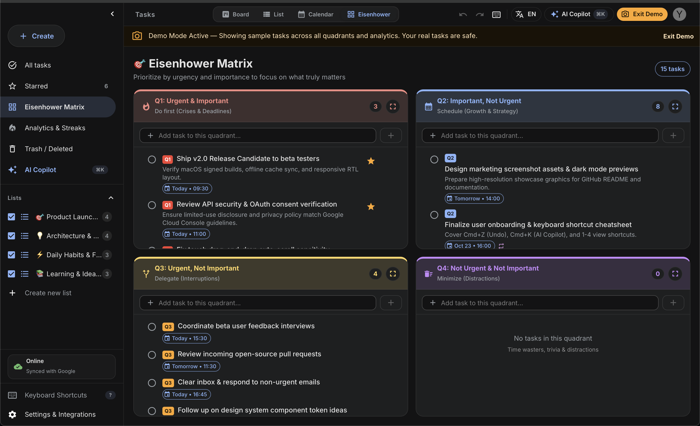
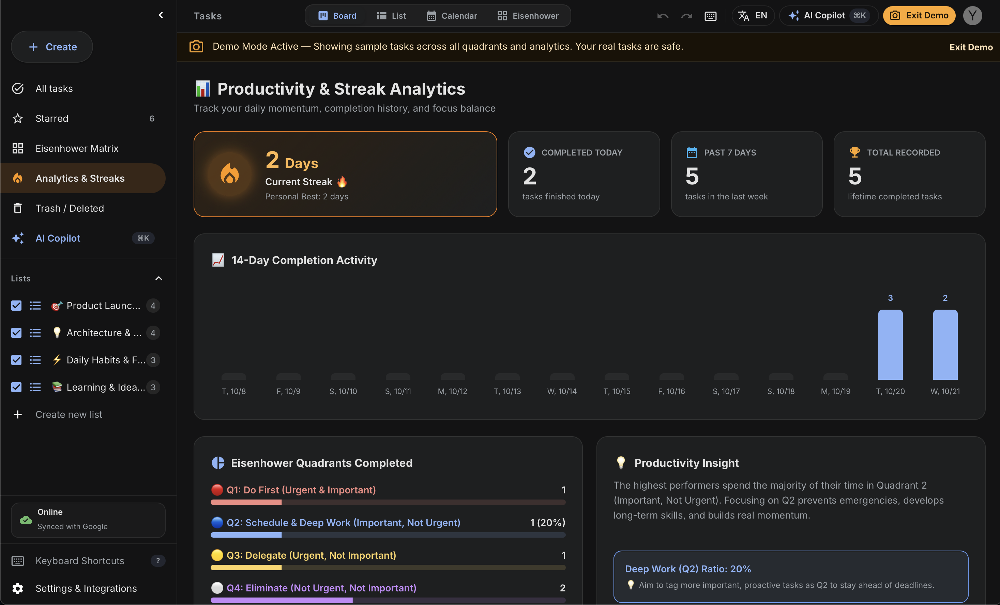
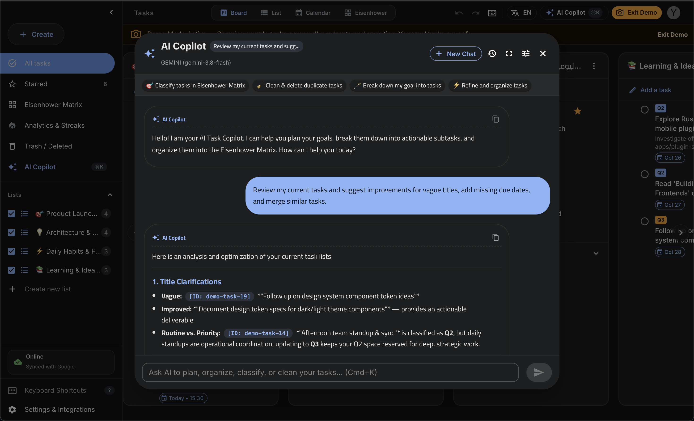
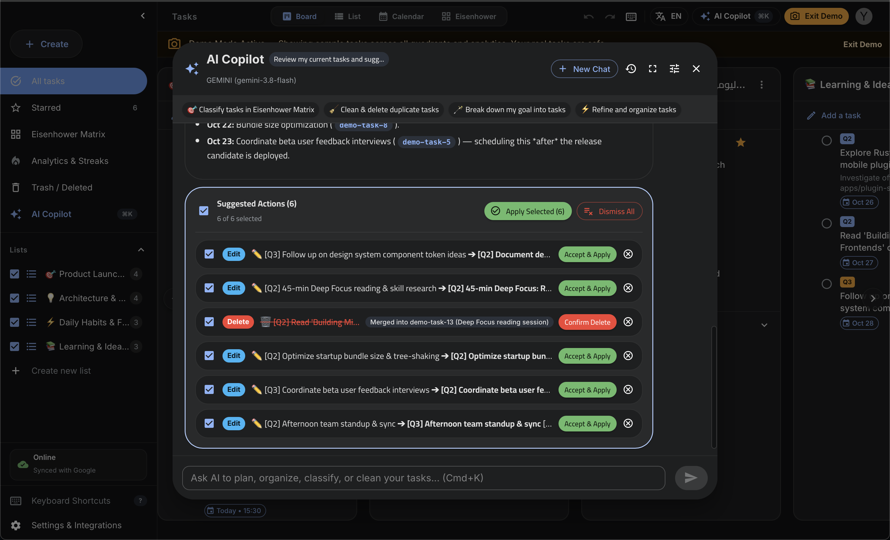

<div align="center">

# 🚀 Google Tasks Pro

**A powerful, modern, offline-first desktop client for Google Tasks with AI Copilot, Eisenhower Matrix, Calendar, Recycle Bin, and bilingual Arabic/English support.**

Built with **Tauri (Rust)** • **React 18** • **TypeScript** • **Material UI (MUI v7)** • **Recoil**

[](https://github.com/YoussefMo7amed/google-tasks-pro/releases)
[](LICENSE)
[](https://tauri.app)
[](src/i18n/)

<br/><br/>



</div>

---

## 📸 Screenshots Showcase

<div align="center">

### 📋 Board View (Multi-Column Kanban)
*Side-by-side horizontal task lists with status filters, tags, and due indicators.*
<br/>


<br/><br/>

### 📑 Unified List View
*Consolidated task feed across all lists with rapid inline search and completion.*
<br/>


<br/><br/>

### 📅 Calendar Agenda View
*Full monthly agenda view to visualize deadlines, overdue tasks, and upcoming schedules.*
<br/>


<br/><br/>

### 🎯 Eisenhower Priority Matrix
*Automated 4-quadrant urgency and importance matrix for deep focus and delegation.*
<br/>


<br/><br/>

### 📈 Analytics & Productivity Streaks
*Track completion velocity, daily productivity streaks, and task distribution statistics.*
<br/>


<br/><br/>

### 🤖 Multi-Provider AI Copilot & 1-Click Task Breakdown
*Conversational AI assistant that understands your tasks, organizes schedules, and generates actionable task items.*

| AI Chat & Contextual Planning | 1-Click Action Execution & Subtasks |
| :---: | :---: |
|  |  |

</div>

---

## ✨ Features Overview

### 🌐 Full Internationalization & Native RTL (English & العربية)
* **True Dual-Language Support:** Seamlessly toggle between **English** and **Arabic (العربية)** anytime without reloading.
* **Pixel-Perfect RTL & LTR:** Intelligent directional mirroring for layouts, icons, typography, and alignments.
* **Zero Memory-Leak Themes:** Statically compiled Material UI theme singletons for both light and dark modes in both directions.

### 🗑️ Smart Recycle Bin & Auto-Clean Retention Timer (Trash)
* **Accidental Delete Protection:** Deleted tasks are safely kept in the local recycle bin with their original list details and notes intact.
* **One-Click Cloud Restore:** Restores any trashed task back to Google Tasks servers and syncs instantly across your devices.
* **Configurable Auto-Clean Timer:** Automatically purges expired tasks:
  * 1 Day (`خلال يوم واحد`)
  * 3 Days / 7 Days / 30 Days
  * Custom Days (`مخصوص`)
  * Never (`أبدًا` — keep until manually emptied)
* **Permanent Deletion & Empty Trash:** One-click confirmation to permanently wipe the bin.

### ↩️ Robust Undo / Redo Engine
* **Full Action Stack:** Undo and Redo support for task creation, deletion, completion, starring, and edits.
* **Cross-Platform Shortcuts:** `Cmd+Z` / `Ctrl+Z` (Undo), `Cmd+Shift+Z` / `Ctrl+Y` (Redo).
* **Bilingual Action Toasts:** Instant feedback showing exactly what action was undone or redone in both English and Arabic.

### 🤖 Built-in AI Copilot (Multi-Provider LLM)
* **Supported AI Engines:** Google Gemini, OpenAI, Ollama (Local), and LM Studio (Local).
* **Multi-Key Management:** Store multiple API keys per provider.
* **Failover Resilience:** Configure **Primary** and **Backup** AI agents with one-click swapping and automatic fallback if quota is exceeded.
* **Context-Aware Assistance:** Ask questions about your tasks, break complex goals into subtasks, organize schedules, and summarize workload.

### 📊 5 Specialized Productivity View Modes
1. **Board View (Multi-Column):** Kanban-style horizontal scrolling columns for all your Google Task lists.
2. **Unified List View:** Single consolidated feed of all your tasks across all lists with quick filtering.
3. **Calendar Agenda View:** Monthly and weekly agenda overview with due-date scheduling.
4. **Eisenhower Matrix:** Automatic 4-quadrant prioritization (Urgent & Important, Urgent & Not Important, etc.).
5. **Analytics & Streaks View:** Visualize completed tasks, productivity rates, and daily completion streaks.

### 🔁 Smart Recurring Tasks Engine & Precision Due Times
* **Repeating Tasks (Repeats):** Flexible recurrence intervals (Daily, Weekly on specific days like Friday, Monthly, Yearly).
* **Configurable End Rules:** Stop repeats `Never`, `On Date`, or `After X Occurrences`.
* **Automatic Next Occurrence:** Completing a recurring task automatically schedules the next instance with its updated due date and syncs to Google Tasks.
* **Precision Due Times:** Choose specific hours and minutes (`HH:mm`) for any task; triggers native macOS notifications at the exact minute.
* **One-Click Eisenhower Quick-Add:** Categorize tasks into Q1, Q2, Q3, or Q4 directly from the creation bar before saving.

### 🍏 Background Mode & macOS Menu Bar System Tray
* **Background Worker:** Closing the window minimizes the app into the background without quitting, keeping task reminders and sync queues running.
* **Top Menu Bar Tray Icon:** Fast tray menu next to macOS clock and Wi-Fi to quickly open, minimize, or truly quit the application.
* **Ultra-Low Resource Footprint:** Idles at **0.0% CPU** with ~50% reduced memory footprint (~25MB Rust backend).

### 💾 Offline-First Architecture & Sync Queue
* **Instant Startup:** Immediate snapshot loading from local cache with zero initial wait time.
* **Offline Mutation Queue:** Create, edit, star, or delete tasks without internet; changes automatically queue and drain to Google Tasks upon reconnecting.
* **Live Sync Status Badge:** Visual indicator displaying pending changes and live sync status.

### ⌨️ Global Keyboard Shortcuts & Cheatsheet
* **Cheatsheet Modal:** Press `?` (or `؟` in Arabic layout) anytime to view the shortcut cheatsheet.
* **Quick Add:** Press `N` or `C` for a new task, `L` for a new list.
* **Tab Cycling:** `Ctrl + Tab` and `Ctrl + Shift + Tab` to smoothly cycle between sidebar views (All, Starred, Eisenhower, Analytics, Trash, Lists).
* **Direct Views:** `1` (Board), `2` (List), `3` (Calendar), `4` (Eisenhower).

---

## 🛠️ Tech Stack & Architecture

| Layer | Technology | Details |
|---|---|---|
| **Frontend** | React 18, TypeScript, Vite | Modern component-driven reactive UI |
| **Desktop Shell** | Tauri v1 (Rust) | Ultra-lightweight native wrapper (<15MB RAM) |
| **UI & Theming** | Material UI (MUI v7), Emotion | Static theme singletons for zero allocations |
| **State Management** | Recoil + Service Layer Singletons | Clean separation of business logic and UI state |
| **Drag & Drop** | `@dnd-kit/core` & `@dnd-kit/sortable` | Smooth task reordering and list manipulation |
| **Storage & Sync** | Tauri Filesystem + LocalStorage | Offline snapshots, sync queues, and local bins |
| **API Integration** | Google Tasks REST API | OAuth2 token handling, multi-account support |

---

## 📥 Getting Started

### 🚀 Download & Install (Pre-built Desktop Apps)

Get the latest official installer for your operating system from the **[Releases](https://github.com/YoussefMo7amed/google-tasks-pro/releases)** page:
* 🍏 **macOS Apple Silicon (M1/M2/M3/M4):** `Google.Tasks.Pro_2.0.0_aarch64.dmg`
* 🍎 **macOS Intel (x86_64):** `Google.Tasks.Pro_2.0.0_x64.dmg`
* 🪟 **Windows (x64):** `Google.Tasks.Pro_2.0.0_x64-setup.exe` or `.msi`
* 🐧 **Linux (x64):** `google-tasks-pro_2.0.0_amd64.deb` or `.AppImage`

> [!TIP]
> **macOS Gatekeeper Note:** Since this is an open-source project without a \$99/yr Apple Developer certificate, macOS Gatekeeper may show: *"Google Tasks Pro is damaged and can't be opened"*.
> Simply run this command in your Terminal after moving the app into `/Applications`:
> ```bash
> xattr -cr "/Applications/Google Tasks Pro.app"
> ```
> Or go to **System Settings ➔ Privacy & Security ➔ Open Anyway**.

### Build From Source

#### Prerequisites
* [Node.js](https://nodejs.org/) (v18 or later)
* [Rust](https://www.rust-lang.org/tools/install) (latest stable)
* npm / yarn / pnpm

### Installation

```bash
# 1. Clone the repository
git clone https://github.com/YoussefMo7amed/google-tasks-pro.git
cd google-tasks-pro

# 2. Install dependencies
npm install

# 3. Start development server with Tauri desktop window
npm run launch:dev
```

### Production Build

```bash
# Typecheck TypeScript
npx tsc --noEmit

# Build production bundle
npm run build

# Package native desktop application (macOS .dmg / Windows .msi)
npm run build:app
```

---

## ⚙️ Google Cloud OAuth Configuration

To connect the application with Google Tasks, you can use the built-in credentials or provide your own Google Cloud project credentials:
* **Step-by-Step Setup Guide:** See [docs/google-cloud-setup.md](./docs/google-cloud-setup.md) for full instructions on setting up your Google Cloud project, enabling the Tasks API, publishing your consent screen, or running in private test mode.
* **In-App Configuration:** You can enter your custom `Client ID` and `Client Secret` directly in the desktop app via **Settings ⚙️ → General → Google OAuth Credentials**.
* Alternatively, supply them in a `.env` file before compiling:
  ```env
  VITE_GOOGLE_CLIENT_ID=your_client_id_here
  VITE_GOOGLE_CLIENT_SECRET=your_client_secret_here
  ```

---

## 📖 Documentation & Legal

* [docs/google-cloud-setup.md](./docs/google-cloud-setup.md) — Complete walkthrough for Google Cloud Console OAuth setup & publishing.
* [docs/privacy-policy.md](./docs/privacy-policy.md) — Application Privacy Policy (zero server-side storage, local-only data flow).
* [docs/terms-of-service.md](./docs/terms-of-service.md) — Terms of Service and open-source license disclaimer.
* [AGENTS.md](./AGENTS.md) — Primary orientation and developer guide for AI coding assistants and contributors.
* [ARCHITECTURE.md](./ARCHITECTURE.md) — Historic architectural notes and refactoring journey.

---

## 👥 Authors & Credits

### 🚀 Maintainer & Lead Developer (v2.0+)
* **[Youssef Mohamed](https://github.com/YoussefMo7amed)**
  * **Smart Recurring Tasks & Precision Times:** Full recurrence engine (Daily/Weekly/Monthly/Custom days), automatic next occurrence generation upon completion, and custom hour/minute notifications.
  * **One-Click Eisenhower Prioritization:** Rapid quadrant tagging (Q1-Q4) integrated directly into the quick-add creation bar.
  * **macOS Menu Bar Tray & Background Worker:** Runs seamlessly in the background with a top menu bar tray icon for uninterrupted notifications and background sync.
  * **Performance & Keep-Alive Optimization:** Zero DOM reconstruction on view navigation, dropping idle CPU to 0.0% and memory footprint by over 50%.
  * **Full Arabic Internationalization & Native RTL:** Complete dual-language engine (`ar` & `en`), zero memory-leak theme singletons, and layout mirroring.
  * **Smart Recycle Bin (Trash):** Accidental delete protection, configurable auto-clean retention timer (1d, 3d, 7d, 30d, custom, never), and 1-click Google Cloud restore.
  * **Robust Undo / Redo System:** Full stack history (`Cmd+Z`, `Cmd+Shift+Z` / `Ctrl+Y`) with localized notifications for task creation, deletion, completion, starring, and updates.
  * **Multi-Provider AI Copilot:** Native integration with Google Gemini, OpenAI, Ollama, and LM Studio featuring multi-key management and Primary/Backup auto-fallback.
  * **5 Advanced Productivity Views:** Horizontal Kanban Board, Unified List, Calendar Agenda View, Eisenhower Matrix (4-quadrant), and Analytics & Streaks.
  * **Global Keyboard Shortcuts & Cheatsheet:** Interactive shortcuts modal (`?` / `؟`), sidebar tab switching (`Ctrl+Tab`), fast view switching (`1`-`4`), quick task (`N`), and list (`L`).
  * **Offline-First Resilience:** Instant local snapshot startup and offline mutation queue with auto-drain on reconnect.

### 💡 Original Author (v1.0)
* **[codad5 (Chukwuemeka Okoye)](https://github.com/codad5/google-task-desktop)**
  * Original concept and foundational Tauri desktop client and Google Tasks API integration.

---

## 📄 License

This project is licensed under the **[GNU General Public License v3 (GPLv3)](./LICENSE)**.
